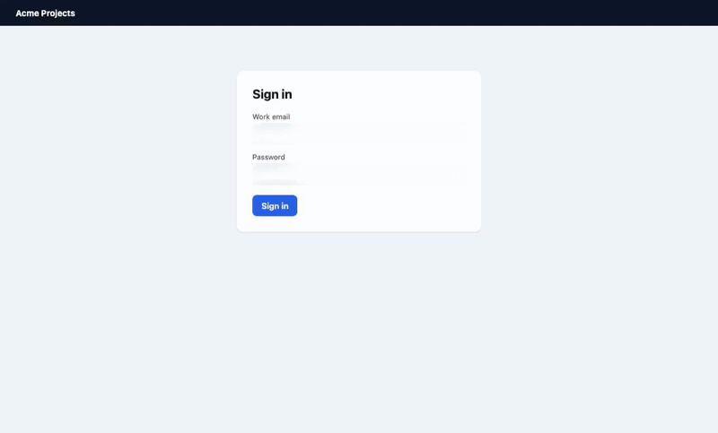
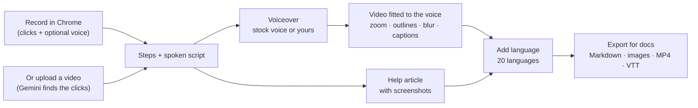
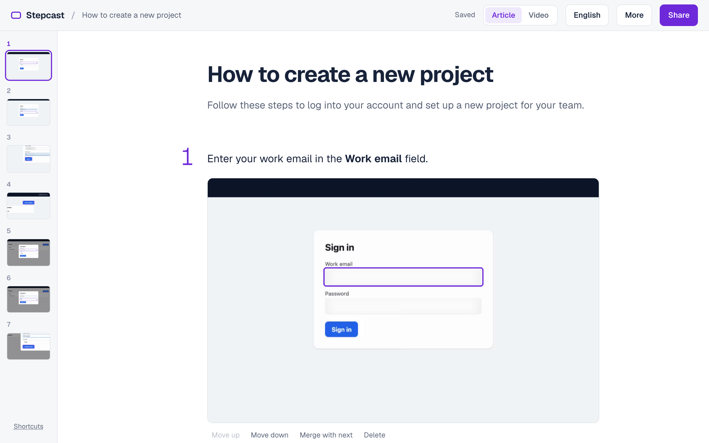
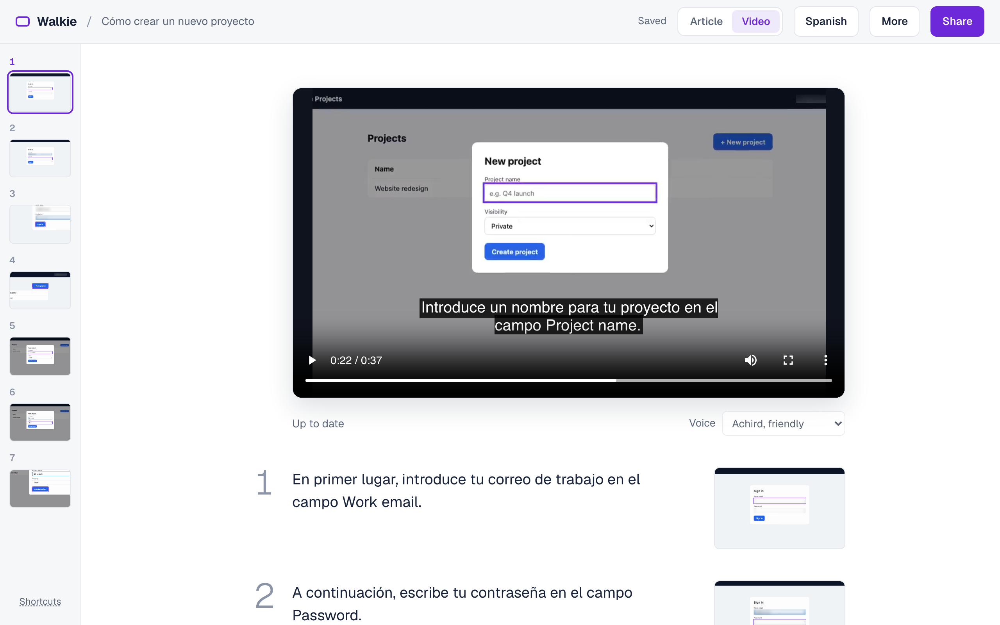
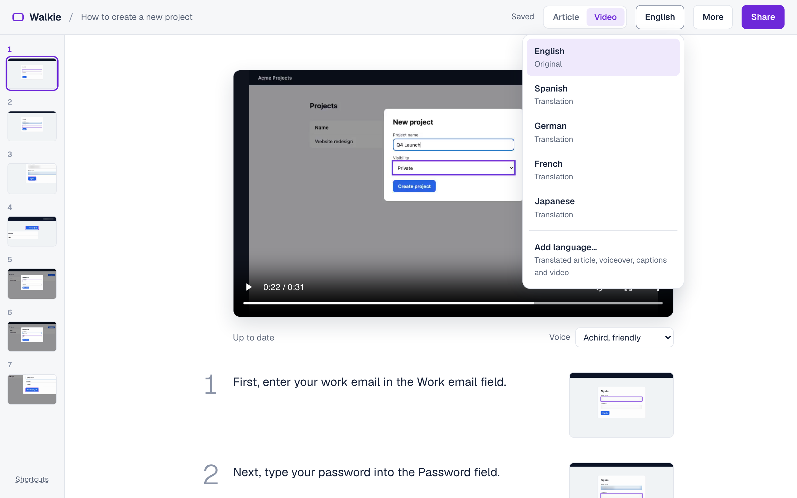
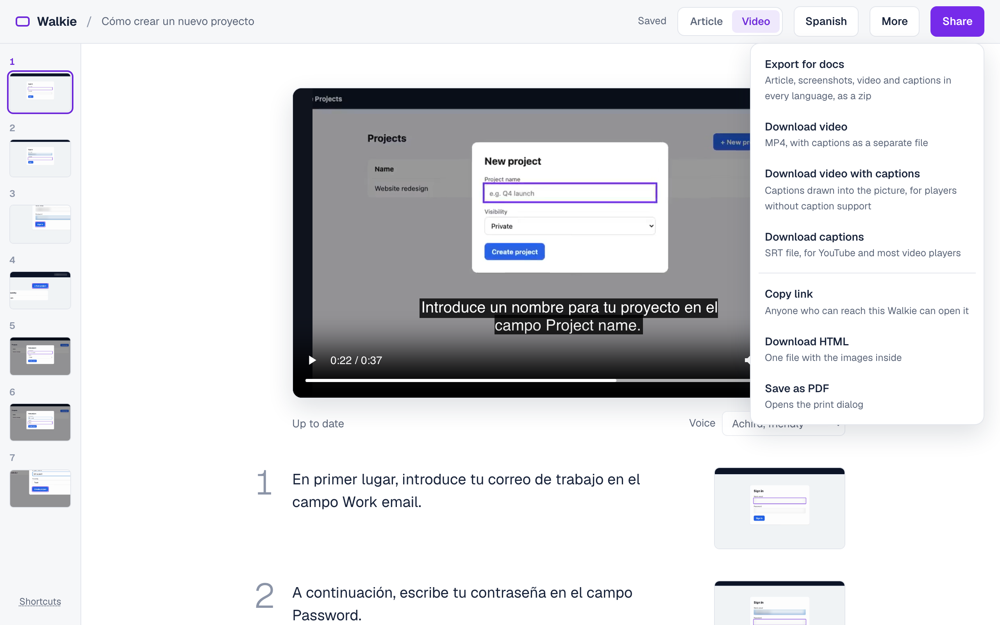

<div align="center">

# Walkie

**Walk through a feature once. Get a narrated tutorial video and a step-by-step help article,<br>
in 20 languages, ready for your docs site.**

[](LICENSE)


[Website](https://aravindsriraj.github.io/walkie/) · [Quick start](#quick-start) · [How it works](#how-it-works) · [Tour](#tour) ·
[Docs sites](#publish-to-your-docs-site) · [FAQ](#faq) · [Developing](#developing)



<sub>Made by Walkie from one recording. The voiceover (captions here, since GIFs are silent), zoom, outlines and
the blurred email address are all automatic.</sub>

</div>

## Why

Recording a product tutorial by hand means retakes, a video editor, and doing it all again for every language and
every UI change. Walkie turns one rough walkthrough, "umm"s and mistakes included, into:

| You do | Walkie does |
|---|---|
| Click through the feature in Chrome, talking if you like | Writes the steps and a tight spoken script |
| | Records a natural voiceover (five reviewed voices, or **your own voice**) |
| | Cuts the video to the voice: zoom and an outline on every click, in sync |
| | Blurs passwords, emails and other personal data for the whole video |
| | Writes the matching help article with screenshots |
| Pick **Add language** | Translates article and script, re-records the voice, re-times the video, adds captions |
| Edit a sentence | Re-records and re-renders only that scene |
| Click **Export for docs** | One zip: Markdown, images, MP4 and captions for every language |

Open source and self-hosted. Your recordings stay on your machine; only the Gemini calls leave it.

## Quick start

You need [Docker](https://www.docker.com/products/docker-desktop/), Google Chrome and a Gemini API key
([get one](https://aistudio.google.com/apikey)).

1. **Add your key**

   ```bash
   echo "GEMINI_API_KEY=your-key" >> server/.env
   ```

2. **Start Walkie**

   ```bash
   docker compose up -d
   ```

3. **Load the recorder:** open `chrome://extensions`, turn on **Developer mode**, click **Load unpacked** and pick
   the `extension/` folder.
4. **Open <http://localhost:8000>**

Then open the page you want to document, click the Walkie icon → **Start recording**, walk through the task and
click **Stop & create article**. The article opens first; the narrated video follows about a minute later under
**Video**.

> [!TIP]
> Already have a screen recording? **Upload a video** on the home page (MP4, MOV or WebM, up to 10 minutes and
> 2 GB). Gemini finds the clicks for you. A visible mouse pointer makes the outlines land more precisely.

<details>
<summary><b>Running Walkie on a shared machine</b></summary>

Start it on any machine your team can reach, then point each person's extension at it: right-click the Walkie
icon → **Options** → enter the address (for example `http://docs-box.internal:8000`). To use a port other than
8000, change `"8000:8000"` in `docker-compose.yml` to, say, `"8080:8000"`.

Walkie has no accounts, so keep it on a private network. See [Privacy](#privacy).

</details>

## How it works



**In sync by design.** Instead of laying a voice over the recording, Walkie fits each scene's footage to its
sentence. A click always lands just after its sentence starts (0.4 s), slow
stretches are sped up (never past 3×) or cut, and the screen holds still when the voice needs longer. Translations
are re-timed the same way, so a longer German sentence never runs into the next click.

## Tour

<details open>
<summary><b>Edit the article</b>: steps and screenshots, written for reading</summary>
<br>


Reword, reorder, merge or delete steps. The article and the narration share steps but have their own wording, so
the article reads like documentation and the voiceover sounds like a person.

</details>

<details>
<summary><b>Edit the video as text</b>: change a sentence, and only that scene is re-rendered</summary>
<br>


Each scene is one sentence. Per scene you can turn the zoom off, hold a busy screen longer, merge or delete. Pick a
voice for the whole video, or **My voice**.

</details>

<details>
<summary><b>Add a language</b>: article, voiceover, captions and video in one click</summary>
<br>


Each language is editable on its own. When you change the original, translated steps are flagged so you can update
them, and your translators' edits are never overwritten. Product names listed under **Settings → Don't translate**
stay as they are.

</details>

<details>
<summary><b>Share and export</b>: a zip for your docs site, or the video alone</summary>
<br>


</details>

## Your own voice

Narrate in your own voice without the retakes. In **Settings → Your voice**, record at least 10 seconds of a sample
paragraph, then read Google's consent sentence. Google requires the consent recording before it copies a voice,
so nobody can clone someone else's. Your voice speaks the translations too (checked in English, Spanish, German,
French and Japanese).

## Publish to your docs site

**Share → Export for docs** gives you one zip:

```text
article.md      video.mp4      video.vtt      images/1.png, 2.png, …
article.es.md   video.es.mp4   video.es.vtt   (and the same for every language)
```

`article.md` embeds the video with its captions and links the images by relative path, so keep the files together.
It compiles as MDX as well as plain Markdown.

<details>
<summary><b>Mintlify, MkDocs, Hugo, GitHub and other Markdown sites</b></summary>

Unzip the files into a folder next to your other pages and add the page to your navigation. Rename `article.md` to
`article.mdx` if your site only reads `.mdx`.

</details>

<details>
<summary><b>Docusaurus</b></summary>

Images work as they are. Docusaurus doesn't serve videos from relative paths, so move `video*.mp4` and `video*.vtt`
into `static/`, and in the `<video>` tag change `video.mp4` to `/video.mp4` and `video.vtt` to `/video.vtt`.

</details>

<details>
<summary><b>GitBook, YouTube and help centers</b></summary>

Upload the MP4 there. For YouTube, add **Share → Download captions** (SRT). For players without caption support,
use **Download video with captions** to get them drawn into the picture.

</details>

## Privacy

- **Blurring:** password, email, phone and card fields, anything marked `data-walkie-redact`, and visible text
  containing an email are blurred in the screenshots and throughout the video. For uploads, Gemini looks for
  personal data every 2 seconds and after every click; check uploads before you share them.
- **What Gemini sees:** blurred screenshots, the text of your steps, and your narration audio when transcribing
  (sent with `store=False`, so Google doesn't keep it).
- **Your voice:** both recordings stay in `server/data/my_voice/`. Gemini makes a temporary voice key from them
  each week and keeps nothing. **Settings → Remove my voice** deletes them.

> [!IMPORTANT]
> Walkie has no accounts: anyone who can reach it can see and edit every article. Run it on one machine or a
> private network, never on the open internet.

## FAQ

<details>
<summary><b>Does the extension record my whole screen?</b></summary>

No. It records only the tab you start it on, your microphone if you allow it, and a log of where you click and what
you type. What you type into password fields never leaves the page.

</details>

<details>
<summary><b>What does it cost?</b></summary>

Walkie is free. Gemini calls are billed to your own API key at Google's rates.

</details>

<details>
<summary><b>Which languages?</b></summary>

English, Spanish, French, German, Italian, Portuguese (Brazil), Dutch, Swedish, Polish, Turkish, Russian,
Ukrainian, Arabic, Hindi, Indonesian, Vietnamese, Thai, Japanese, Korean and Chinese (Simplified). The screen stays
in the language you recorded it in.

</details>

<details>
<summary><b>Do I have to talk while recording?</b></summary>

No. Without narration, Walkie writes the script from your steps. If you do talk, stumbles and "umm"s are fine:
the script is rewritten, and the voiceover is recorded fresh.

</details>

<details>
<summary><b>My product changed. Do I re-record everything?</b></summary>

Only the parts that changed. Edit the wording and the scene re-renders; delete or merge scenes that no longer apply.
A new flow needs a new recording.

</details>

## Troubleshooting

<details>
<summary><b>"No API key was provided"</b></summary>

Put `GEMINI_API_KEY=…` in `server/.env`, or export it in the shell you run `docker compose up` from, then run
`docker compose up -d` again.

</details>

<details>
<summary><b>The extension can't reach Walkie</b></summary>

Check <http://localhost:8000> opens. If Walkie runs elsewhere or on another port, set the address in the
extension's **Options**.

</details>

<details>
<summary><b>"Captions in this language can't be drawn into the video here"</b></summary>

Arabic, Hindi and Thai need a text shaper to draw captions into the picture. The Docker image has one; outside
Docker, use the captions file instead (players show it correctly), or install Pillow with `raqm`.

</details>

## Developing

Needs `uv`, Node 20+, `ffmpeg` 7 or newer, Chrome, and `GEMINI_API_KEY` in your shell.

```bash
cd server && uv sync && uv run uvicorn app.api:app --host 127.0.0.1 --port 8000 --reload
cd web && npm install && npm run dev          # http://localhost:5173, forwards API calls to :8000
cd web && npm run dev:site                     # the website (web/site); npm run build:site builds it into web/dist-site
```

Set the extension's address to `http://localhost:5173` while developing.

| Part | What | Stack |
|---|---|---|
| `extension/` | Chrome recorder: tab video, optional mic, click and typing log, what to blur | MV3, plain JS |
| `server/` | API, video rendering, Gemini calls, exports | FastAPI, `google-genai`, ffmpeg, Pillow |
| `web/` | Article and video editor | React + Vite |
| `e2e/` | Real-extension end-to-end test and demo app | Playwright |

<details>
<summary><b>Tests and checks</b></summary>

```bash
cd server && uv run pytest tests/unit tests/integration   # integration calls Gemini (needs GEMINI_API_KEY)
cd extension && npm test
cd web && npx vitest run
cd e2e && npm install && npm test   # real extension in Chromium: record → article → video
cd server && uv run python scripts/voice_samples.py out/   # voices in 5 languages: listen, plus word-error check
cd server && uv run python scripts/check_highlights.py data/<article id>   # do upload outlines sit on the click?
cd server && uv run python scripts/landing_media.py <article id>   # website demo videos + text, from a recording of e2e/site/crm
```

</details>

<details>
<summary><b>Settings</b></summary>

- `WALKIE_DATA`: data folder (default `server/data`)
- `WALKIE_API`: where the web dev server forwards API calls
- `WALKIE_CAPTION_FONT`: a font file for burned-in captions, if no installed font covers your language

</details>

Designs are in `docs/superpowers/specs/`, plans in `docs/superpowers/plans/`.

## License

Apache-2.0, see [LICENSE](LICENSE). Copyright 2026 TR Aravindan.
